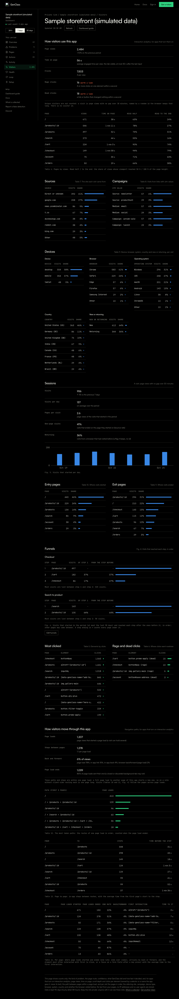
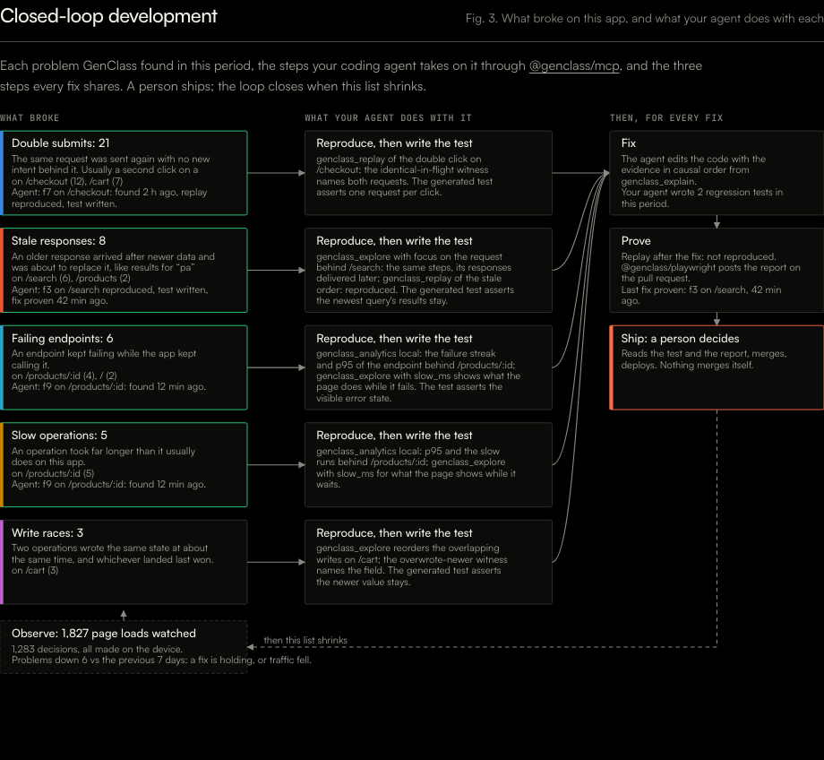

# Evidence: the 2026-10-25 batch on `main` at b41862d

Six pull requests merged into `main` today, one after another, each rebased on the one before:

| PR | what | merge commit |
|---|---|---|
| [#95](https://github.com/genclass-dev/GenClass-lib/pull/95) | `npx @genclass/runtime@beta scan <url>` (alias `audit`) and the `genclass_scan` MCP tool | 0b67ee8 |
| [#98](https://github.com/genclass-dev/GenClass-lib/pull/98) | issue 94: `summary().requests`, the `request-stalled` check, `init` writes `defer`, the install-time note | 651aa1c |
| [#97](https://github.com/genclass-dev/GenClass-lib/pull/97) | dashboard product analytics (visits, sources, devices, entry and exit pages, funnels) and the Copy-prompt button | 9568fc1 |
| [#96](https://github.com/genclass-dev/GenClass-lib/pull/96) | every install line names the newest runtime; `analytics` on an old runtime warns | c472b4b |
| [#99](https://github.com/genclass-dev/GenClass-lib/pull/99) | measured checks `ad-heavy` and `text-warped`; navigation paths in the analytics opt-in | b41862d |
| [genclass-site#11](https://github.com/genclass-dev/genclass-site/pull/11) | genclass.dev runs 0.3.0-beta.1 with the visual checks on; the scan command advertised | site `main` |

Everything below was run on this Mac against `main` at b41862d after the last merge, in a clean worktree, with
Chromium 153 through Playwright 1.63.0 and the worker served locally by `wrangler dev --local` (D1 and R2 emulated,
migrations 0001 to 0010 applied). Raw outputs: [`run.log`](run.log), [`scan-cli.txt`](scan-cli.txt),
[`scan-ads.json`](scan-ads.json).

## 1. Test suites

| suite | command | result |
|---|---|---|
| runtime typecheck and build | `npm run typecheck -w @genclass/runtime && npm run build -w @genclass/runtime` | clean |
| runtime unit tests | the vitest run from AGENTS.md | 1,209 passed, 14 skipped (the model-parity tests that need `GENCLASS_MODEL_DIR`) |
| runtime timing budgets | `test/review-perf.test.ts` | 4 of 4 |
| first load | `node test/first-load-size.mjs dist` | `/auto` 108.369 KB gzip, main entry 100.272 KB (limits 108.6 / 100.48) |
| telemetry worker | `npx vitest run` in `telemetry-worker` | 316 passed |
| `@genclass/mcp` | typecheck, build, vitest | 130 passed |
| `@genclass/playwright` | typecheck, build, vitest | 108 passed |
| **visual checks in Chromium** | `npx playwright test --config test/browser/visual/playwright.config.ts` | **49 passed** (the 23 older kinds, the two new ones, and the review regressions) |
| **MCP race e2e in Chromium** | `node packages/mcp/test/e2e/race.e2e.mjs` | replay on the buggy page: reproduced; the generated test: fails on the bug, passes on the fix; replay on the fixed page: not reproduced; explore on the fixed page: no race |
| **Playwright fixture e2e in Chromium** | `node packages/playwright/test/e2e/run.mjs` | the race report written and printed, exit 0 |

The same suites ran green in GitHub Actions on each PR before it merged (every PR was merged only with CI green and
after merging the `main` that preceded it).

## 2. The scan command on real pages (Chromium, local)

The visual suite's own fixture server serves the pages with their images, as the suite does. One clean page and three
pages with planted faults:

| page | score | what it reported |
|---|---|---|
| `clean.html` | **100 / 100, no problems** | nothing: no false report on the clean page |
| `ads.html` | 51 / 100 | `ad-heavy` medium on desktop and phone (ad slots and ad-sized cross-site frames over the threshold), `page-overflow-x` high on phone |
| `ads-interstitial.html` | 75 / 100 | `ad-heavy` high: a full-screen ad on top of the page |
| `layout.html` | 37 / 100 | `page-overflow-x`, `text-invisible`, `css-var-undefined`, `image-distorted` |

Each report names the element, its selector, what was measured and a suggested CSS fix; `--json` gives the same as
JSON (`scan-ads.json`). Exit codes: 0 with no problems, 1 with problems, as documented.

A first run served the fixtures with a plain static server that does not generate the placeholder images; the scan
then reported four broken images on `clean.html`. Those images really were 404 under that server, so that was a
correct report, not a false one; the table above is the rerun with the suite's server.

## 3. The dashboard, in Chromium

The screen recording of the walk-through (Overview, Problems, Visitors, Loop on the sample app):
[`dashboard-walkthrough.webm`](dashboard-walkthrough.webm) (1280 x 860, 2.4 MB).

**Overview** ([01-overview.png](01-overview.png)) and **Problems** ([02-problems.png](02-problems.png)): unchanged
by the batch, included as the baseline the new views sit next to.

**Visitors** ([03-visitors.png](03-visitors.png)): the new product analytics from PR 97 and the navigation paths from
PR 99, read from the sample's stats. Sections rendered, in order: How visitors use this app, Sources, Campaigns, Devices
(Device, Browser, Operating system, Country, New or returning), Sessions, Entry pages, Exit pages, Funnels (Checkout,
Search to product), Most clicked, Rage and dead clicks, and the path section.

**Loop** ([04-loop.png](04-loop.png), the figure alone in [05-loop-figure.png](05-loop-figure.png)): one row per
problem kind on the sample (double submits, stale responses, failing endpoints, slow operations, write races), the
agent's step for each, Fix, Prove, Ship and back to Observe. Three rows carry the agent's reports from the sample:
`duplicate (agent f7)`, `stale (agent f3)`, `failing` and `slow` (agent f9). The foot reads "Your agent reported 3
findings in this period".

**A fresh app without analytics** ([07-new-app-overview.png](07-new-app-overview.png),
[08-visitors-empty-state.png](08-visitors-empty-state.png)): created through `POST /api/projects` on the local worker,
one telemetry batch posted (runtime 0.3.0-beta.1, no analytics). Its Visitors view is the empty state with the one big
button first, "Copy the prompt for your coding agent", 368 x 58 px, and two lines under it.

**The Copy-prompt button, clicked** ([09-copy-prompt-copied.png](09-copy-prompt-copied.png)): the label reads
"Copied" and the clipboard holds the 1,837-character prompt, which names `@genclass/runtime@beta`, `analytics: true`
and the consent step (`runtime.analytics.start()`). Checked twice: in headless Chromium with clipboard permission
(reading the clicked node directly), and in the desktop app's embedded browser by hand.

## 4. Two things the browser run found, fixed in this PR

- **The copy button could end in "Could not copy" with nothing to fall back on.** In the embedded browser the
  Clipboard API refused the write (`NotAllowedError: Write permission denied`). The dashboard's copy helper now tries
  the synchronous `execCommand("copy")` path on the click first, then the Clipboard API, and when both refuse it shows
  the prompt in a selected textarea under the button ("Selected, now copy"). After the change the embedded browser
  shows "Copied". `test/pages.test.ts` pins the hidden textarea.
- **Two README lines were no longer true.** PR 97 added a visit flag in `localStorage`; the root README and the
  package README still said "nothing is stored on the device". Both now say what is stored and how it is removed, in
  line with TELEMETRY.md.

## 5. Measured numbers the new checks ship with (from `docs/runtime/RESULTS.md`)

- **Section 22, `ad-heavy` and `text-warped`** (PR 99): on the clean demos (7 pages, 28 page views) and templates (4,
  16 page views), **0 findings, 0 false reports**. Planted faults: `text-warped` 95 of 95 found on the demos and 15 of
  15 on the templates; `ad-heavy` 14 of 14. A mechanism check written by the checks' author, not an independent recall
  figure. One false report in the first Chromium run (`text-overflow: ellipsis` clamped lines) was excluded by rule.
- **Section 21, `request-stalled`** (PR 98): on the demos, 10 clean runs per demo with **0 false reports**, 10 chaos
  runs with 0 findings, and the planted stall found 3 of 3 times per demo.
- The compat apps and the public-site bench (`bench/visual`, GitHub Actions only) were **not** run on the new
  checks; that is the next measurement before the checks are called proven on sites nobody here wrote.

## 6. How this was done

1. Each of the six tasks ran in its own session on Opus 5.5 in its own git worktree, from a brief that named the
   rules it had to keep (no model-visible text change, measured checks only, opt-in telemetry with disclosure, no new
   dependencies) and what done looked like.
2. Each PR had to be green in CI before merging. Because all five library PRs touched the same files (the CHANGELOG,
   API.md, `types.ts`, the dashboard page, the analytics code and the disclosures), they merged one at a time in the
   order 95, 98, 97, 96, 99; after each merge, the sessions still open merged `main` into their branch, resolved,
   reran their checks and pushed, and GitHub re-ran CI on the merge commit before the next merge.
3. On the final `main`, every suite in section 1 ran again on this machine, including the three browser suites.
4. The dashboard was served locally by `wrangler dev` and driven by Playwright: the walk-through was recorded, each
   view screenshotted, and the new app created through the real API with a real telemetry batch, so the empty state
   and the button are what a user gets, not a mock.
5. The scan command ran against pages served the way the visual suite serves them, with a clean page as the control.

## 7. Reliability

The implementation is reliable for what was measured: every unit, worker, package and browser suite passes on `main`;
the new checks produced no false report on the clean demos and templates and found every planted fault; the scan
reports nothing on a clean page and the planted faults on faulty ones; the dashboard views render from real stats and
the copy button works in two browsers. Two limits stay: the public-site and compat bench has not run on the new checks,
and nothing from this batch is deployed yet (migration 0010 and `wrangler deploy` for the worker; the site's
`wrangler deploy`; the `@genclass/mcp` release for the scan tool and the reporter).
