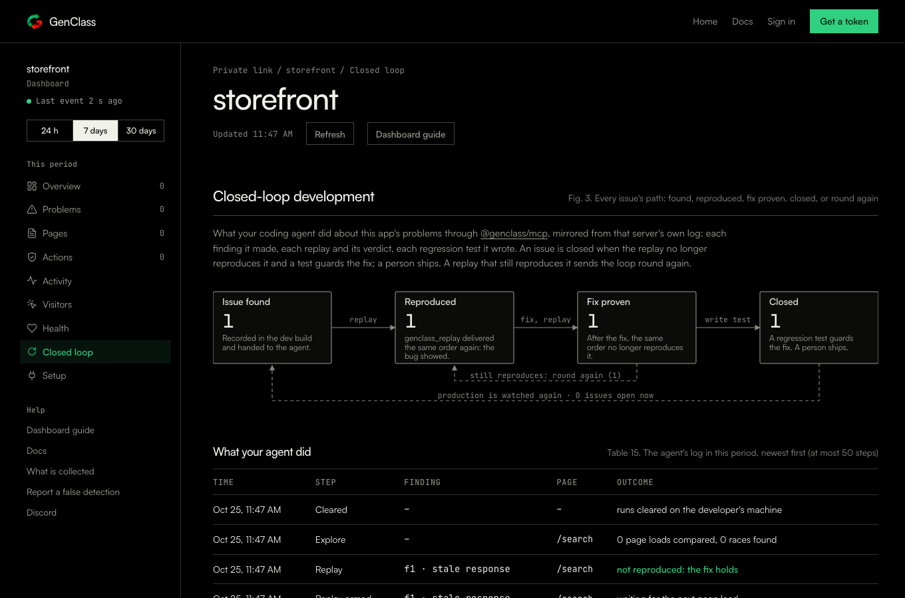
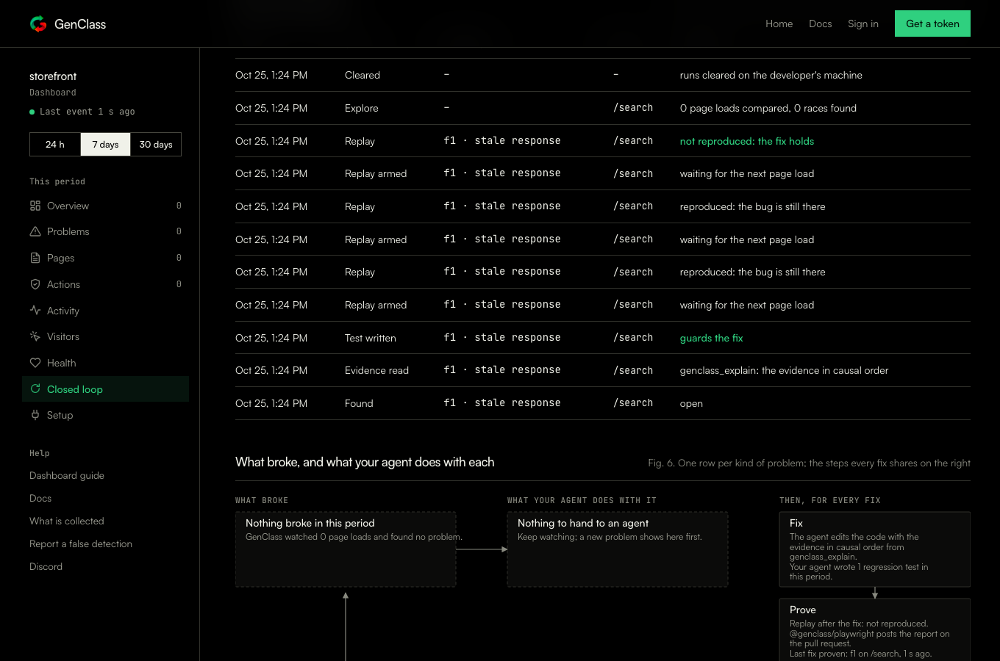
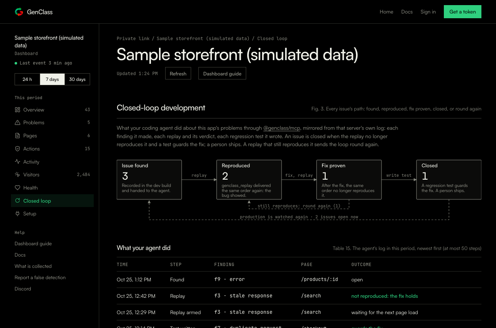

# Evidence: the closed loop on the dashboard

What this shows: with `GENCLASS_REPORT` set, `@genclass/mcp` mirrors its log of the loop to the app's GenClass
dashboard, and the dashboard's **Closed loop** view draws every issue's path (found, reproduced, fix proven, closed,
or round again) with the period's counts and lists the log under it. Design and wire format:
[docs/runtime/AGENT.md](../../runtime/AGENT.md) section 4.5; the code is in `packages/mcp/src/report.ts`,
`packages/mcp/src/server.ts`, `telemetry-worker/src/dashboard.ts`, `telemetry-worker/src/pages.ts` and migration
`telemetry-worker/migrations/0011_agent_log.sql`.

Everything below is produced by one command and nothing in it is mocked at the seams: the real MCP `Store` and
reporter post into the collector's real request handler, which writes to the real D1 schema (every migration run by
`node:sqlite`), the real `stats()` reads it back, and the real dashboard page renders it, first in happy-dom for the
checks, then in Chromium for the recording.

## Run it

From the repository root, after `npm ci` (Node 20 or later):

```bash
bash docs/evidence/closed-loop-dashboard/run.sh
```

It needs Playwright's Chromium for the recording (`npx playwright install chromium`) and `ffmpeg` for the GIF
(without it the `.webm` is still written). It runs four steps and writes `run.log` here:

1. **Collector tests**: `telemetry-worker/test/agent.test.ts` (the `/agent` route, storage, the stages, the log and
   its cap, migration 0011 on a populated database, retention) and the Fig. 3 and Table 15 tests in
   `telemetry-worker/test/pages.test.ts`.
2. **MCP tests**: `packages/mcp/test/report.test.ts` (the reporter: target, events, batching, failures swallowed, the
   API wrapper) and `packages/mcp/test/mcp.test.ts`.
3. **End to end**: `loop.e2e.ts` (run with `npx vite-node`), the round trip described below. It also writes
   `page-e2e.html` and `page-sample.html`, the dashboard with that run's stats and the sample app's stats inlined,
   which the recording opens (both are generated and not committed).
4. **Recording**: `record.mjs` opens those pages in Chromium, clicks the sidebar's "Closed loop", scrolls through
   Fig. 3, Table 15 and Fig. 6, and saves `closed-loop.webm`, `closed-loop.gif` and the three screenshots.

To run one step alone: `cd telemetry-worker && npx vitest run test/agent.test.ts test/pages.test.ts -t "agent|closed loop"`,
`cd packages/mcp && npx vitest run test/report.test.ts`, `npx vite-node docs/evidence/closed-loop-dashboard/loop.e2e.ts`,
`node docs/evidence/closed-loop-dashboard/record.mjs`.

## The round trip (`loop.e2e.ts`)

One finding goes through the whole loop, with every step mirrored:

| step | what happens on the developer's machine | what the dashboard records |
|---|---|---|
| 1 | a dev-build page load reports a stale write; the bridge makes finding `f1` (`stale-write`, `/search`) | `found` |
| 2 | the agent calls `genclass_explain`: the evidence, and the regression test is generated | `explain`, `test` |
| 3 | the agent arms a replay; the page loads with the recorded order; the witness comes back: **reproduced** | `armed`, `replay` reproduced |
| 4 | a first fix is tried; the replay still reproduces it: **round again** | `armed`, `replay` reproduced |
| 5 | the real fix; the replay no longer reproduces it: **fix proven**, and with the test, **closed** | `armed`, `replay` not reproduced |
| 6 | an explore session is reported and the runs are cleared | `explore`, `cleared` |

The script prints, from `run.log`:

- the one HTTP call the reporter made, `POST /api/projects/<secret>/agent -> 200 {"ok":true,"stored":11}`, and that
  nothing it sent contains page text (`react`, `items`, `Search`, `overwrote`, `q=reac` all absent);
- the `agent_reports` row: found, explained, reproduced once, `reproduced_n` 2, tested, proven;
- the eleven `agent_log` rows in order;
- `stats().agent.stages`: `{ found: 1, explained: 1, reproduced: 1, fixed: 1, closed: 1, open: 0, continued: 1 }`;
- the rendered page: sidebar "Closed loop", heading "Closed-loop development", Fig. 3 `found=1 reproduced=1 fixed=1
  closed=1`, its labels `replay | fix, replay | write test | still reproduces: round again (1) | production is watched
  again · 0 issues open now`, and the eleven Table 15 rows with their outcomes.

Fig. 6 (the per-kind figure) shows "Nothing broke in this period" in this run because it draws production telemetry,
and the round trip sends none; the sample page shows it filled.

## Recording


`closed-loop.webm` is the same recording at full size. First the page from the round trip, then the sample app
(three findings: one closed after a fix that did not hold, one reproduced and tested, one found).

| | |
|---|---|
|  |  |
|  | |

## What is not covered here

- The real `@genclass/mcp` process end to end over stdio with a real page: the round trip drives the same `Store`,
  `reportingApi` and `createReporter` the process uses, with the reporter's `fetch` pointed at the collector's
  `handle()` instead of the network. `packages/mcp/test/mcp.test.ts` covers the process.
- The deployed collector. Migration 0011 was applied to the remote D1 on 2026-10-25
  (`cd telemetry-worker && npx --yes wrangler@4 d1 migrations apply genclass-dashboard --remote`, with a login that
  has the D1 scope; it is additive, so the worker running the previous code keeps working); the worker itself is
  deployed separately (`npx --yes wrangler@4 deploy` from `telemetry-worker/`).
